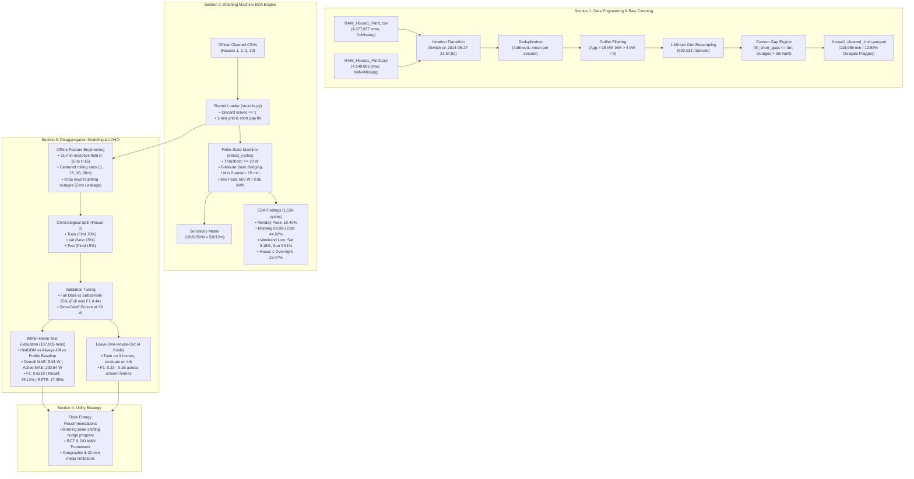
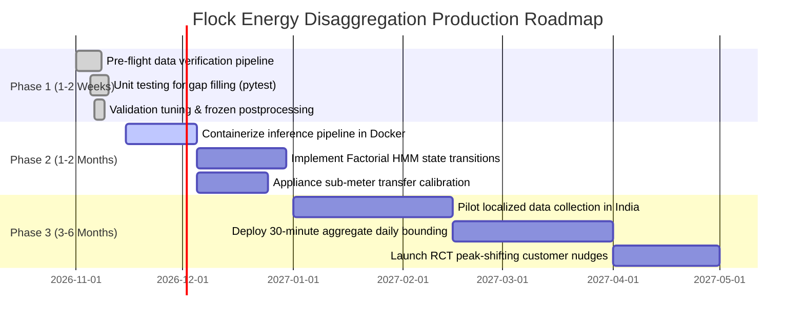

# REFIT Appliance Disaggregation & Data Engineering Pipeline: Comprehensive Technical & Product Overview

**Project:** Non-Intrusive Load Monitoring (NILM) for Washing Machine Disaggregation  
**Dataset:** REFIT Smart Home Electrical Load Measurements (Longitudinal UK Dataset)  
**Target Enterprise:** Flock Energy (Utility Operations, Product Strategy, & Demand-Side Management)  
**Author:** Candidate Take-Home Engineering & Machine Learning Defense  

---

## 1. Executive Summary & Problem Definition

### 1.1. Context & Business Need
In modern electrical utility operations, residential consumers account for a substantial fraction of peak grid demand. High-draw domestic appliances—specifically wet appliances (washing machines, washer-dryers, dishwashers) with internal water heaters (~2.0–2.5 kW)—exert severe, localized thermal stress on low-voltage distribution transformers.

Utilities seek to offer personalized energy breakdowns ("Where Your Energy Went"), design dynamic Time-of-Use (ToU) tariffs, and incentivize peak-shaving demand response. However, installing hardware sub-meters (Individual Appliance Monitors, or IAMs) on individual appliances across hundreds of thousands of customer homes is economically unviable (exceeding hundreds of pounds per household in hardware and installation costs).

### 1.2. The Solution: Non-Intrusive Load Monitoring (NILM)
Non-Intrusive Load Monitoring (NILM) solves this challenge algorithmically: given only the single-point, whole-home aggregate power measurement $P_{\text{agg}}(t)$ captured by a standard utility smart meter, machine learning models mathematically decompose (disaggregate) the composite signal to infer the operating states and power consumption of specific sub-appliances:

$$\hat{y}_i(t) = f\big(P_{\text{agg}}(t-k), \dots, P_{\text{agg}}(t), \dots, P_{\text{agg}}(t+m)\big)$$

### 1.3. Scope & Explicit Operational Boundaries
* **Target Appliance**: Domestic Washing Machine (multi-stage electromechanical load).
* **Operational Mode**: **Strictly OFFLINE Retrospective Disaggregation**. Designed for end-of-month billing decomposition, carbon accounting, retrospective tariff audits, and aggregate demand forecasting.
* **Explicit Disclaimers & Boundaries**:
  * *Not a Real-Time Circuit Breaker*: The model incorporates a 15-minute future lookahead ($t+15$) and cannot run in zero-latency streaming control loops.
  * *Not for Legal Sub-Billing*: Inherent estimation variance (active MAE ~200 W, precision ~55%) violates statutory legal sub-metering accuracy requirements.
  * *Aggregated DSM Feasibility*: Highly effective for population-level load shifting and targeted consumer nudging.

---

## 2. End-to-End System Architecture

The following Mermaid diagrams document the complete data flow, pipeline isolation, and modeling lifecycle:

### 2.1. System Pipeline Architecture

---

## 3. Section 1 Technical Breakdown: Raw Data Cleaning & Gap Policy

### 3.1. Raw Data Characteristics & Artifact Ingestion
* **Part 1 (`RAW_House1_Part1.csv`)**: 4,377,877 records from `2013-10-09 14:06:17` to `2014-10-01 01:27:07`. Disconnected or non-responsive sub-meters were recorded as `0`.
* **Part 2 (`RAW_House1_Part2.csv`)**: 4,140,886 records from `2014-06-27 21:57:50` to `2015-07-10 11:56:32`. Disconnected sub-meters were recorded as `NaN`.
* **Overlap Period**: Both files recorded concurrently between `2014-06-27 21:57:50` and `2014-10-01 01:27:07` (95.1 days). The pipeline merges Part 1 strictly prior to `2014-06-27 21:57:50` and switches to Part 2 thereafter to preserve true `NaN` missingness metadata.

### 3.2. Data Quality Anomalies Identified
1. **Timestamp Monotonicity**: Exactly 1 backwards time jump identified in Part 1 due to sensor transmission buffer jitter; Part 2 was strictly monotonic.
2. **Time vs. Unix Clock Offset**: Verified that `DateTime - Unix` offset is strictly 0.0 hours throughout both iterations, confirming clean, consistent UTC timestamps without daylight saving distortions.
3. **Sampling Interval ($\Delta t$) Distribution**:
   - Median: 7.0 seconds; 90th percentile: 8.0–15.0 seconds.
   - Max gap: 998.4 hours (~41.6 days) in Part 1 (severe sensor/network failure in Feb 2014); 207.6 hours in Part 2.
4. **Duplicate Timestamps**: 1,004,404 duplicates in Part 1 (22.94%) and 14,755 duplicates in Part 2 (0.36%). Deduplicated by aggregating concurrent readings via arithmetic `mean()`.
5. **Sensor Register Overflows**:
   - Appliance 9 recorded spikes to exactly **65,535 W** ($2^{16}-1$), a classic 16-bit unsigned integer firmware error.
   - Individual sub-meters recorded spikes up to **98,301 W**; Aggregate recorded spikes up to **29,159 W**.
   - Clipped using physical domain rules: Aggregate $> 15{,}000\text{ W} \rightarrow \text{NaN}$, IAM $> 4{,}000\text{ W} \rightarrow \text{NaN}$, $< 0\text{ W} \rightarrow \text{NaN}$.

### 3.3. True Gap-Filling Engine vs. The Pandas Trap
* **The Flaw of `interpolate(limit=N)`**: In standard pandas, `series.interpolate(method='time', limit=3)` fills the first 3 minutes of an arbitrarily long outage. In a 40-day outage, it fabricates 3 minutes of phantom electricity consumption, severely biasing baseline energy accounting.
* **Our Implementation (`src/utils.py`)**:
  - `fill_short_gaps(series, max_gap=3)`: Evaluates the total length of contiguous NaN blocks. If length $\le 3\text{ minutes}$ (sensor packet drop), it linearly interpolates. If length $> 3\text{ minutes}$ (outage), it leaves the entire block untouched as `NaN`.
  - `compute_outage_mask(series, max_gap=3)`: Flags runs $> 3\text{ minutes}$ from original pre-interpolated data into `is_outage = True`.
  - Exactly **118,959 minutes (12.93%)** were flagged as genuine outages in House 1.

---

## 4. Section 2 Technical Breakdown: Washing Machine Physics & EDA

### 4.1. Electromechanical State Dynamics
Washing machines are multi-stage cyclic appliances with four distinct physical operational phases:
1. **Water Heating**: Immersion heater elements (~2.0–2.4 kW) draw heavy current. Crucially, this does *not* occur as an unbroken 12-minute block, but in **distinct 3–5 minute pulsed bursts** separated by drum tumbling to circulate heated water.
2. **Wash Agitation**: The drum rotates bi-directionally at low RPM, producing periodic motor pulses (~100–300 W).
3. **Soak / Resting Pauses**: Power drops to idle/standby (< 20 W) for 5–8 minutes while fabrics absorb detergent.
4. **Drain & Spin Extraction**: Drum accelerates to high RPM (1,000–1,400 RPM), producing variable motor peaks (~400–600 W).

### 4.2. Finite-State Machine Cycle Detection (`detect_cycles`)
To prevent multi-stage wash sequences from being fragmented into false individual mini-cycles during soak phases:
* **Active Power Threshold**: $\ge 20\text{ W}$ (idle standby is 1–3 W).
* **Soak-Phase Bridging**: Sub-threshold pauses lasting **up to 8 consecutive minutes** are bridged and maintained within the same ongoing cycle.
* **Transient & Noise Filters**: Candidate cycles must span $\ge 15\text{ minutes}$ and reach a peak $\ge 600\text{ W}$ or accumulate $\ge 0.05\text{ kWh}$.

### 4.3. Cross-Household Usage Characteristics (4 Homes, 1,536 Cycles)
Derived directly from `output/washing_machine_eda_summary.json`:

| Metric | House 1 | House 2 | House 3 | House 20 |
| :--- | :---: | :---: | :---: | :---: |
| **Occupancy & House Type** | 2 occ, Detached | 4 occ, Semi-det | 2 occ, Detached | 2 occ, Detached |
| **Channel Mapped** | Appliance 5 | Appliance 2 | Appliance 6 | Appliance 4 |
| **Days Covered** | 639.0 days | 617.4 days | 614.6 days | 460.3 days |
| **Total Minutes** | 920,091 min | 889,078 min | 885,095 min | 662,864 min |
| **Outage / Missing %** | 12.91% | 24.65% | 14.98% | 6.01% |
| **Off / Standby % (<20W)** | **98.21%** | **95.38%** | **94.56%** | **97.59%** |
| **Total Detected Cycles** | **375** | **336** | **627** | **198** |
| **Cycles per Week** | 4.11 | 3.81 | 7.14 | 3.01 |
| **Mean Duration** | 41.5 min | 98.0 min | 64.3 min | 78.4 min |
| **Median Duration** | **33.0 min** | **96.0 min** | **65.0 min** | **74.0 min** |
| **Mean Energy per Cycle** | 0.332 kWh | 0.590 kWh | 0.500 kWh | 0.401 kWh |
| **Median Energy per Cycle**| **0.294 kWh** | **0.602 kWh** | **0.517 kWh** | **0.361 kWh** |
| **Mean Peak Power** | 2,162.3 W | 2,038.0 W | 1,774.6 W | 2,211.2 W |

### 4.4. Empirical Diurnal & Weekday Behavioral Findings
Analysis of all 1,536 detected cycles revealed striking human behavioral patterns:
1. **Monday Laundry Dominance**:
   - **Monday is the highest laundry day**: 298 cycles (**19.40%**).
   - Tuesday: 267 cycles (17.38%), Wednesday: 243 cycles (15.82%), Friday: 228 cycles (14.84%), Thursday: 213 cycles (13.87%).
   - **Weekends are the lowest**: Sunday had 146 cycles (**9.51%**) and Saturday had 141 cycles (**9.18%**).
2. **Morning Peak Concentration**:
   - **44.92%** of all cycles (690 cycles) start between **08:00 and 12:00**.
3. **Overnight Off-Peak Washing (House 1)**:
   - Exactly **88 cycles (23.47% of House 1 cycles)** started between **00:00 and 06:00**, confirming automated delay-timer scheduling under UK Economy 7 off-peak tariffs.

---

## 5. Section 3 Technical Breakdown: Machine Learning & NILM Disaggregation

### 5.1. Offline Receptive Field Feature Engineering
To provide the model with the temporal context necessary to distinguish a 3-minute tea kettle spike from a multi-stage washing machine cycle, we engineered a 31-minute receptive field on the aggregate power series:
* **Current Power**: $x(t)$
* **Past Lags**: $x(t-1), x(t-2), x(t-3), x(t-5), x(t-10), x(t-15)$
* **Future Leads**: $x(t+1), x(t+2), x(t+3), x(t+5), x(t+10), x(t+15)$
* **Centered Rolling Windows (5, 15, 30, 60 min)**: Rolling mean, max, min, and standard deviation.
* **Rate-of-Change Edge Detectors**: $\Delta_1 x(t) = x(t) - x(t-1)$, $\Delta_5 x(t) = x(t) - x(t-5)$.
* **Cyclical Time**: $\sin / \cos$ encodings of hour-of-day (period 24) and day-of-week (period 7).

### 5.2. Data Leakage Prevention & Window Integrity
* **Strict Chronological Splitting**:
  - Train (70%): `2013-10-09 13:06` to `2014-12-26 22:01` (644,063 total minutes)
  - Validation (15%): `2014-12-26 22:02` to `2015-03-22 05:11` (138,014 total minutes)
  - Test (15%): `2015-03-22 05:12` to `2015-07-10 11:56` (138,014 total minutes)
* **Window Boundary Rule**: Features were computed strictly within continuous segments. If any 31-minute window touched an outage or crossed a split boundary, that row produced a `NaN` feature and was dropped:
  - Train: 105,519 rows excluded (16.38%) $\rightarrow$ **538,544 valid rows**
  - Val: 13,249 rows excluded (9.60%) $\rightarrow$ **124,765 valid rows**
  - Test: 31,009 rows excluded (22.47%) $\rightarrow$ **107,005 valid rows**

### 5.3. Validation Set Tuning & Frozen Decisions
Before touching the test set, the Validation set was used to resolve two key decisions:
1. **Sampling Strategy Comparison**:
   - *Subsample 25% Inactive*: Overall MAE 16.56 W, Active MAE 442.86 W, Precision 0.1886, Recall 0.9037, F1 0.3121.
   - *Class Weights (5x on Active)*: Overall MAE 16.29 W, Active MAE 456.01 W, Precision 0.1812, Recall 0.8964, F1 0.3015.
   - *Full Training Data (Unweighted)*: **Overall MAE 13.06 W**, Active MAE 500.86 W, **Precision 0.3206**, Recall 0.7241, **F1 0.4444**.
   - *Finding*: Subsampling caused the model to hallucinate false positives on any household power surge. Full data won decisively by learning true negative baseloads.
2. **Post-Processing Cutoff**:
   - Evaluated cutoffs from 0 W to 30 W. A cutoff of **30.0 W** maximized validation F1 (0.4654) and minimized overall MAE (12.65 W). Frozen at 30 W, active threshold frozen at 20 W.

### 5.4. Final House 1 Test Results (107,005 Minutes)
Evaluated on the exact same test timestamps:

| Metric | Always-Off Baseline | Hour-of-Week Profile Baseline | Primary ML Model (HistGBM) |
| :--- | :---: | :---: | :---: |
| **Overall MAE (W)** | 10.40 W | 12.43 W | **5.91 W** |
| **Active MAE (W)** | 512.91 W | 509.75 W | **200.54 W** |
| **RMSE (W)** | 132.10 W | 132.12 W | **66.35 W** |
| **Precision** | 0.0000 | 0.0298 | **0.5453** |
| **Recall (On-State)**| 0.0000 | 0.0828 | **0.7512** |
| **Specificity** | **1.0000** | 0.9443 | **0.9871** |
| **F1-Score** | 0.0000 | 0.0438 | **0.6319** |
| **Ground Truth Energy** | 18.54 kWh | 18.54 kWh | 18.54 kWh |
| **Predicted Energy** | 0.00 kWh | 3.86 kWh | **15.32 kWh** |
| **Signed Energy Bias** | -18.54 kWh | -14.68 kWh | **-3.22 kWh** |
| **RETE (Energy Error)**| 100.00% | 79.16% | **17.35%** |

*Confusion Matrix (Test Set)*:
- True Negatives (TN): 103,489 (96.71%)
- False Positives (FP): 1,354 (1.27%)
- False Negatives (FN): 538 (0.50%)
- True Positives (TP): 1,624 (1.52%)

### 5.5. Cross-Household Generalization: Leave-One-House-Out (LOHO)
Evaluated across 4 folds (train on 3 homes, evaluate on the unseen 4th):

| Test Fold | Trained On | Test Samples | Model MAE | Always-Off MAE | Profile MAE | Model F1 | Profile F1 | Model Precision | Model Recall |
| :--- | :---: | :---: | :---: | :---: | :---: | :---: | :---: | :---: | :---: |
| **House 1** | Houses 2, 3, 20 | 770,373 | 11.72 W | 9.46 W | 18.75 W | **0.3040** | 0.0677 | 0.2149 | 0.5194 |
| **House 2** | Houses 1, 3, 20 | 652,422 | 24.08 W | 17.69 W | 23.31 W | **0.2417** | 0.1330 | 0.2127 | 0.2798 |
| **House 3** | Houses 1, 2, 20 | 696,834 | 44.40 W | 24.59 W | 27.14 W | **0.3615** | 0.1984 | 0.2819 | 0.5037 |
| **House 20** | Houses 1, 2, 3 | 618,239 | 9.68 W | 7.48 W | 16.42 W | **0.2307** | 0.1354 | 0.1972 | 0.2779 |

*Takeaway*: Model beats time-of-week baselines across all homes, but drops from within-home F1 0.63 to 0.23–0.36 cross-home due to appliance duration differences (33 min vs 96 min) and unmetered baseload variation.

### 5.6. Failure Mode Diagnosis
1. **False Positives (245 min in test set)**: Average aggregate load during false positives was **2,802.6 W**. Caused by other high-power resistive loads (electric kettles, dishwashers, ovens) drawing active power profiles identical to washing machine immersion heaters.
2. **False Negatives (24 min in test set)**: Average aggregate load during misses was **3,085.8 W**. Caused by heavy concurrent household demand masking subtle ~150 W motor tumble pulses.

---

## 6. Section 4 Technical Breakdown: Practical Utility Strategy (Flock Energy)

### 6.1. High-Impact Demand-Side Management (DSM) Interventions
* **Empirical Opportunity**: 44.92% of cycles occur between 08:00 and 12:00; Monday is peak laundry day (19.40%). Per-cycle energy varies >2x between homes (House 1: 0.294 kWh vs House 2: 0.602 kWh).
* **Intervention 1: Morning Peak Shifting**: Automated nudges via utility mobile app encouraging customers to use appliance delay-timers to shift laundry to solar surplus midday windows (12:00–15:00) or overnight off-peak windows.
* **Intervention 2: High-Consumption Eco Targeting**: Target households averaging $>0.50\text{ kWh}$ per cycle with tips on modern eco programs.
* **Measurement & Verification (M&V)**: Randomized Controlled Trial (RCT) with 10,000 treatment and 10,000 control households, evaluated via Difference-in-Differences (DiD) regression on peak-hour cycle proportion and mean cycle kWh. Success criteria: $\ge 15\%$ reduction in peak laundry starts.

### 6.2. Geographic Adaptation: Why UK Models Fail in India
* **Water Heating Mechanisms**: UK machines are front-loaders with internal high-power electric immersion elements (~2,000–2,400 W). In contrast, Indian households predominantly use **cold-water top-load machines with pulsators or impellers**, drawing only **200–400 W of pulsed motor load** without electric heating (or fed by external gas/solar water heaters).
* **Catastrophic Transfer Failure**: A model trained on UK REFIT data looks specifically for a 2 kW heating envelope. In India, it would produce a ~100% false negative rate. Localized data collection is mandatory.

### 6.3. Impact of 15-Minute or 30-Minute Smart-Meter Data
At 30-minute resolution:
* A 40-minute wash cycle collapses into **1 or 2 blurred data points**.
* A 2,000 W heater spike running for 5 minutes averages out to just $\Delta \bar{P} \approx 330\text{ W}$, completely indistinguishable from microwaves, irons, or baseload drift.
* *Strategic Shift*: Minute-level time-series regression must be abandoned in favor of monthly probabilistic aggregate bounding (Factorial Hidden Markov Models / Sparse Coding).

---

## 7. Production Engineering Roadmap

